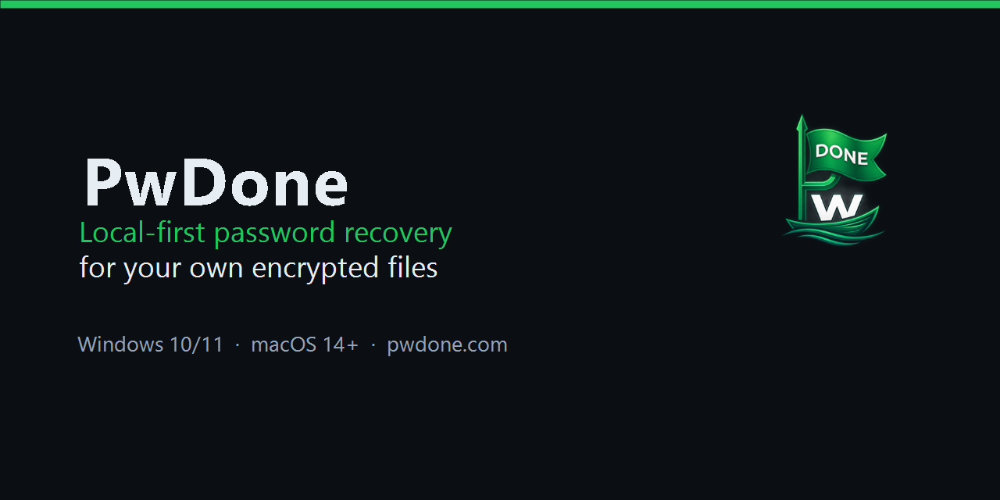

  

# PwDone

**Local-first password recovery for your own encrypted files.**

PwDone helps you regain access to your own password-protected ZIP, RAR, 7z,
PDF, Word, Excel and PowerPoint files. Everything runs on your device: files,
hashes and recovered passwords never leave your computer.

[Website](https://pwdone.com) · [Download](https://pwdone.com/download) · [Documentation](https://pwdone.com/docs) · [Pricing](https://pwdone.com/pricing) · [Compare](https://pwdone.com/alternatives)

## What we build

PwDone is a desktop app for Windows and macOS that turns professional recovery
engines into a guided workflow:

- Detect the file format and extract a recovery hash locally.
- Validate and normalize the hash.
- Run Hashcat (GPU) or John the Ripper (CPU) with live progress.
- Show the recovered password, or suggest another approach.

No command line, no hash modes, no uploads.

## Why local-first

- Your files, hashes and recovered passwords never leave your device.
- No account is required.
- No telemetry or usage tracking in the app.
- Recovery history stays local and can be cleared at any time.

Read the [privacy policy](https://pwdone.com/privacy).

## Product

- **PwDone** — password recovery for ZIP, RAR, 7z, PDF, Word, Excel and PowerPoint.
- **Product hub** — [github.com/pwdone/pwdone](https://github.com/pwdone/pwdone):
  downloads, release notes, issue tracking and localized screenshots.

## Languages

The app is available in English, 简体中文, 繁體中文, 日本語, 한국어, Deutsch,
Español, Français, Italiano, Nederlands, Polski and Português.

## Press and support

- Press kit: <https://pwdone.com/press>
- Support: <support@pwdone.com>
- Security: see [SECURITY.md](https://github.com/pwdone/pwdone/blob/main/SECURITY.md)

---

PwDone is built by an independent developer. Sales are handled by our
merchant of record.
